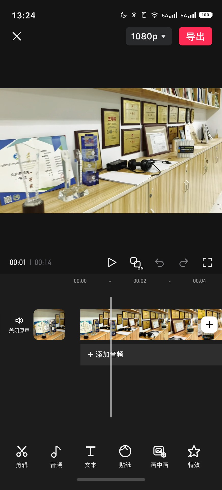
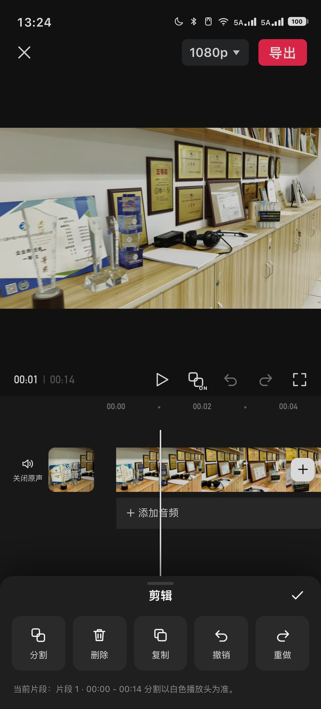

# 剪映风格竖屏视频剪辑 Demo

双击 `index.html`，在 Chrome / Edge / Safari 中打开即可（无需本地服务器）。示例素材为 `assets/sample-browser.mp4`。

页面按 436 × 960 的竖屏尺寸设计：手机浏览器上铺满屏幕；桌面浏览器会把界面居中成一块手机画幅，方便对照设计稿。

## 界面

| 区域 | 内容 |
| --- | --- |
| 顶部 | 关闭（退出确认）、1080p 分辨率菜单、导出 |
| 预览 | 视频画面、文字 / 贴纸 / 画中画浮层、点击画面播放或暂停 |
| 控制条 | 当前时间 / 总时长、播放暂停、分割（ON）、撤销、重做、全屏预览 |
| 时间轴 | 时间刻度、固定白色播放头、封面、真实视频帧缩略图、关闭原声、添加音频、+ 添加素材 |
| 底部工具 | 剪辑、音频、文本、贴纸、画中画、特效、素材（可横向滑动） |

## 交互一览

| 控件 | 行为 |
| --- | --- |
| 播放 | 播放 / 暂停；从头播完后再次播放会回到 0 秒 |
| 时间轴 | 左右拖动定位；点击刻度或空白处把播放头移到点击位置；点片段选中片段 |
| 分割 | 在白色播放头处拆分当前片段，播放头在片段边缘或没有片段时用 Toast 提示 |
| 撤销 / 重做 | 撤销 / 重做分割、删除、复制、导入、排序等编辑操作 |
| 关闭原声 | 静音 / 恢复原视频声音 |
| 封面 | 打开「设置封面」弹窗，使用当前画面作为封面 |
| + 添加素材 | 选择本地视频，插入到当前片段之后 |
| 添加音频 | 选择本地音频，生成紫色音轨并跟随播放头播放；可更换或移除 |
| 1080p | 在 480P / 720P / 1080P / 2K / 4K 间切换，影响导出弹窗中的信息 |
| 导出 | 打开导出弹窗并播放进度动画（演示模式，不生成真实文件） |
| 全屏 | 进入 / 退出纯画面预览，可用右上角 × 或 Esc 退出 |
| 剪辑 | 分割、删除、复制、撤销、重做 |
| 文本 | 输入文字或点预设，添加到画面中央；点文字右上角 × 删除 |
| 贴纸 | 选择 Emoji 贴纸叠加到画面，点击画面上的贴纸即可移除 |
| 画中画 | 选择本地视频叠加到右下角，跟随主视频播放，可移除 |
| 特效 | 原片 / 黑白 / 暖阳 / 冷调 / 复古，仅作用于预览画面 |
| 素材 | 本地视频、添加文本、添加贴纸、添加音频 |
| 关闭 × | 退出确认，确认后显示「已退出编辑」页面，可重新进入 |

键盘快捷键（桌面）：`Space` 播放/暂停，`←` `→` 前后 1 秒，`S` 分割，`M` 静音，`Esc` 关闭面板 / 退出预览。

## 演示范围

这是界面与交互演示，以下功能没有接真实的视频合成：

- 导出：展示进度与成功状态，但不会生成文件。
- 文字 / 贴纸 / 画中画 / 特效：以浮层和 CSS 滤镜方式预览，不写入合成视频。
- 添加的音频：用 `Audio` 元素按项目时间跟随预览播放，不参与最终导出。
- 片段排序：`editor.moveClip` 仍然可用；本界面把横向拖动绑定为定位，未再绑定长按排序。

## 文件

| 文件 | 原负责方 | 职责 |
| --- | --- | --- |
| `index.html` | Mac | 竖屏界面结构、SVG 图标、面板与弹窗容器 |
| `styles.css` | Mac | 深色剪映风格、手机画幅、播放头、时间轴、面板动画 |
| `ui.js` | Mac | 状态渲染、时间轴手势、抽帧缩略图、面板 / 弹窗 / 快捷键 |
| `editor.js` | Windows | 项目状态、素材定位、分割、删除、复制、撤销重做、静音与素材清理 |

## 接口约定

`createEditor(video)` 创建编辑器。`subscribe(listener)` 立即发送一次状态，并在状态变化后再次通知，返回取消订阅函数。

状态字段：`clips`、`currentTime`、`duration`、`selectedClipId`、`playing`、`muted`、`canSplit`、`canUndo`、`canRedo`、`error`。

| 调用 | 行为 |
| --- | --- |
| `seek(seconds)` | 按项目时间定位到素材画面，更新白线并选中所在片段 |
| `selectClip(clipId)` | 选中片段；播放头不在该片段时跳到片段起点 |
| `splitAtPlayhead()` | 在选中片段内部按白线位置分割 |
| `deleteClip(clipId)` | 删除片段 |
| `duplicateClip(clipId)` | 在原片段之后复制一份 |
| `moveClip(clipId, toIndex)` | 把片段移动到指定的零基索引 |
| `undo()` / `redo()` | 撤销 / 重做最近一次片段编辑 |
| `insertVideo(file)` | 读取本地视频，插入到播放头所在片段之后 |
| `togglePlayback()` | 开始或暂停项目预览 |
| `toggleMute()` | 切换预览原声静音 |

时间统一用秒。片段用稳定的 ID 识别，`start` 和 `end` 是素材时间，项目位置由前面片段的时长累加。分割时左段保留原 ID，右段获得新 ID。

撤销 / 重做记录只包含片段编辑（分割、删除、复制、导入、排序）；文字、贴纸、音频、画中画和特效属于界面层，不进入编辑器历史。

## 实现细节

- 缩略图使用隐藏的 `<video>` 抽帧到 `<canvas>`，并按（素材 + 0.25 秒）缓存。因此拖动时间轴、分割、撤销后缩略图可以立即复用，不会出现空白帧。
- 时间轴以白色播放头为基准：内容层整体平移，刻度、封面、片段和音轨共用同一套「项目时间 → 屏幕坐标」换算。
- 编辑面板、弹窗和 Toast 都限制在手机画幅内，桌面端不会跑到手机外面。
- 所有按钮都绑定了事件；不可用的操作（例如播放头在片段边缘时分割）会显示 Toast，而不是静默失效。
